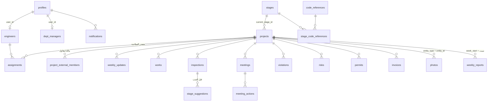

# سواعد للإشراف الهندسي — مخطط قاعدة البيانات وسياسات RLS

## الملفات

| الملف | المحتوى |
|---|---|
| `supabase/migrations/…01_core_schema.sql` | الجداول والقيود والفهارس |
| `supabase/migrations/…02_rls.sql` | دوال الصلاحية وسياسات RLS لكل جدول |
| `supabase/migrations/…03_logic.sql` | الحسابات، والتدقيق، ومنع التعارض، والتحديث المتسلسل، والملخص اليومي، والتقرير الأسبوعي |
| `supabase/migrations/…04_platform.sql` | ربط الحسابات، وStorage، وRealtime، وpg_cron |
| `supabase/seed.sql` | قائمة مراجع الكود والإعدادات الافتراضية |
| `supabase/sql-tests/` | 153 اختباراً آلياً للصلاحيات والمنطق: `supabase/sql-tests/run_local.sh` |

## التقنية: كما في البرومت، بلا تغيير

اخترنا Supabase لأن متطلب «الصلاحيات في قاعدة البيانات» يتحقق فيه مباشرة عبر RLS في PostgreSQL. ويوفّر أيضاً المعاملات (transactions) التي يحتاجها التحديث المتسلسل، وتحترم Realtime فيه نفس سياسات RLS. أما Firestore الحالي فلا يدعم مشغّلات داخل نفس المعاملة.

## مخطط العلاقات



## قرارات تحتاج علمك

1. **المعرّفات من نوع `text`.** بهذا تبقى معرّفات المنصة الحالية كما هي عند الاستيراد، ويولّد الجهاز غير المتصل معرّف السجل (uuid) بنفسه قبل المزامنة.
2. **كل جدول ميداني يحمل `project_id`.** بذلك تُكتب RLS بنفس النمط في كل الجداول وتُختبر مرة واحدة. أما `meeting_actions.project_id` و`photos.project_id` فتضبطهما المشغّلات من السجل الأب، ولا يُقبل ما يرسله العميل.
3. **مصدر الصلاحية جداول وليس حقولاً.** الصلاحيات تأتي من ثلاثة جداول: `assignments` للمشاريع، و`dept_managers` لمدير القسم، و`profiles.is_admin` لمدير النظام. ولا يستطيع أحد غير مدير النظام تعديل `is_admin`، ويمنع ذلك مشغّل في قاعدة البيانات.
4. **التكليف الساري** هو الذي `from_date` فيه فارغ أو ≤ اليوم، و`to_date` فارغ أو ≥ اليوم، بتوقيت الرياض، ويشترط أن يكون المهندس `active`. يُحسب ذلك عند كل استعلام، فإذا انتهى التكليف سُحبت الصلاحية فوراً دون أي مهمة مجدولة.
5. **حذف المهندس.** RLS تخفي الصفوف عن المهندس عند الحذف، فيرجع الطلب بصفر صفوف بدلاً من رسالة خطأ. ستعرض الواجهة زر الحذف لمن يملك الصلاحية فقط.
6. **المهندس لا يعدّل صف المشروع مباشرة.** تتغير مرحلة المشروع ونسبته عبر التحديث الأسبوعي أو بتأكيد اقتراح نقل المرحلة. أما مدير المشروع فيعدّل بيانات مشروعه، ولا يحذف المشروع نفسه.
7. **النسبة في التحديث الأسبوعي.** إذا تُركت فارغة تُحسب من أوزان المراحل، وإذا أُدخلت قيمة صارت نسبة يدوية. ولا يُطبَّق على المشروع إلا التحديث **الأحدث تاريخاً**، حتى لا يُرجع تحديثٌ قديم تأخرت مزامنته المشروعَ للخلف.
8. **التعارض بين الأجهزة.** لكل سجل عمود `version`. يرسل العميل الإصدار الذي قرأه، فإذا كان قديماً رفض الخادم التعديل بالخطأ `P0409` ومعه الإصداران، فتعرض الواجهة الاختلاف بدلاً من الكتابة فوق التعديل الآخر.
9. **الحذف أثناء انقطاع الاتصال.** يُسجَّل كل حذف في `sync_tombstones`، فيعرف الجهاز عند عودة الاتصال ما حُذف أثناء غيابه.
10. **التقرير المعتمد لا يتغيّر.** لقطة البيانات (`snapshot`) تُجمَّد عند الاعتماد، وإعادة التوليد يوم الخميس لا تمس إلا المسودات.

## مصفوفة الصلاحيات (كما تفرضها RLS)

| الجدول | مدير النظام | مدير القسم | مدير مشروع (مشروعه) | مهندس (مشروعه) | مالك/مقاول |
|---|---|---|---|---|---|
| projects | الكل | الكل | قراءة + تعديل | قراءة | قراءة مشروعه |
| الوحدات الميدانية* | الكل | الكل | قراءة/إضافة/تعديل/**حذف** | قراءة/إضافة/تعديل | — |
| violations, inspections | الكل | الكل + **التصعيد** | كما سبق | كما سبق، بلا تصعيد | قراءة |
| weekly_reports | الكل | الكل | **اعتماد** + حذف المسودة | قراءة | المعتمد فقط |
| external_responses | قراءة | قراءة | قراءة | قراءة | إضافة |
| engineers, assignments | إدارة | إدارة | قراءة فريقه | قراءة فريقه | — |
| dept_managers | إدارة | قراءة | قراءة | قراءة | — |
| stages, code_references, app_settings | إدارة | قراءة | قراءة | قراءة | قراءة |
| audit_log | قراءة | قراءة | قراءة مشروعه | — | — |
| notifications | ما يخصّه | ما يخصّه | ما يخصّه | ما يخصّه | ما يخصّه |

\* الوحدات الميدانية: weekly_updates, works, inspections, stage_suggestions, meetings, meeting_actions, violations, risks, permits, invoices, photos.

لا يملك `anon` أي صلاحية على الجداول. وجدولا `audit_log` و`notifications` تكتب فيهما المشغّلات فقط، والعمود الوحيد الذي يعدّله المستخدم في الإشعار هو `read_at`. وتطبّق ملفات Storage نفس القواعد، لأن مسار كل ملف يبدأ بـ`{project_id}/`.

## التحديث المتسلسل (داخل نفس المعاملة)

| الحدث | ما يحدث |
|---|---|
| إدخال/تعديل `weekly_updates` | تتحدّث مرحلة المشروع وحالته ونسبته و`last_update_date` إذا كان هو الأحدث |
| قبول `inspection_request` في مرحلة `is_pour_gate` | يُنشأ `stage_suggestions` بانتظار التأكيد ← `decide_stage_suggestion()` |
| مخالفة `major` | إشعار فوري لمديري المشروع الحاليين ولمديري القسم (مرة واحدة) |
| يومياً 04:00 UTC (7:00 الرياض) | `run_daily_digest()`: بنود محاضر متأخرة، تراخيص بعد 30 أو 7 أيام، تحديثات متأخرة عن 7 أيام، مخالفات تجاوزت مهلتها. إشعار واحد لكل مستخدم يقتصر على مشاريعه |
| الخميس 09:00 UTC | `generate_weekly_reports()`: مسودة لكل مشروع نشط تجمع بيانات الأسبوع من السبت إلى الجمعة |
| أي تغيير | سطر في `audit_log` يحفظ المنفّذ والوقت والقيمة قبل التعديل وبعده، ثم يبثه Realtime لكل من يحق له رؤيته |

إرسال Push عبر FCM أو APNs أو Web Push، وتوليد PDF، ستتولاهما Edge Functions عند إدراج سطر في `notifications` أو عند اعتماد تقرير. هذا ضمن المرحلة 3.

## الاختبارات

```bash
supabase/sql-tests/run_local.sh     # Postgres 16 مؤقت + المهاجرات + 153 اختباراً
```

تتحقق الاختبارات من:
- مدير المشروع لا يقرأ أي سجل من المشروع B في أي جدول، بما فيها سجل التدقيق والصور والتقارير.
- المهندس لا يحذف من أي وحدة.
- التكليف المنتهي أو الذي لم يبدأ لا يمنح أي صلاحية، وإنهاء التكليف يسحب الصلاحية فوراً.
- لا يستطيع أحد منح نفسه صلاحية مدير النظام.
- المالك لا يرى المسودات.
- حساب النسبة من الأوزان، ودرجة المخاطر، وحالات «متأخر»، والأسبوع من السبت إلى الجمعة.
- التحديث المتسلسل، ومنع التعارض، والتدقيق، والملخص اليومي، والتقرير الأسبوعي.

## القرارات المعتمدة (المهاجرة 5 وما بعدها)

1. **مراحل «قبل الصب»:** تُحدَّد من الإدارة ← المراحل (`is_pour_gate`). سكربت الاستيراد يعلّم آلياً المراحل التي يدل اسمها على صب: أساسات، ميدات، هيكل، سقف.
2. **ما يراه المالك والمقاول:** كل المخالفات وطلبات الفحص في مشروعهما، مع الرد عليها، والتقارير المعتمدة فقط.
3. **البيانات الأساسية للمشروع** (الاسم، والمالك، والأرقام، والقسم، ووضع الإشراف، ونوع المستخلص): لمدير القسم ومدير النظام فقط، ويفرض ذلك المشغّل `guard_project_master`. مدير المشروع يعدّل الحالة والمرحلة وتفصيلها والنسبة اليدوية.
4. **المهاجرات اللاحقة:**
   - **6:** `generate_weekly_report`, `send_weekly_report`, `save_stages` (حفظ ذرّي للأوزان), `add_external_member`.
   - **7:** البريد الأسبوعي.
   - **8:** نشر كل الجداول في Realtime.
